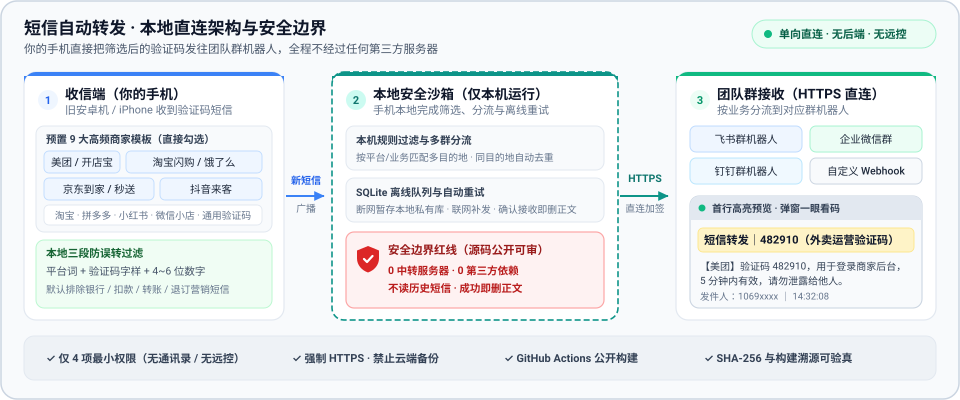

# 短信转飞书（SMS Forwarder）

专为国内电商、本地生活团队共享账号收验证码（**美团、淘宝闪购/饿了么、京东到家/秒送、抖音来客、淘宝/天猫/千牛、拼多多商家、小红书、微信小店**）以及个人备用机接码设计的开源短信转发工具。

无中转服务器、无统计埋点、无远程控制，手机本地完成过滤后，通过 HTTPS 直连转发到你自己的 **飞书、企业微信、钉钉或自定义 Webhook**，支持按业务多群分流。



## 快速下载与上手

首次部署建议先看[完整使用手册（HANDBOOK.md）](HANDBOOK.md)，3 分钟完成机器人配置、模板勾选与国产手机放行。

| 平台 | 推荐方式 | 获取与指南 | 适用场景 |
| :--- | :--- | :--- | :--- |
| **Android（推荐主力）** | 安装正式版 APK | [直接下载最新 APK](https://github.com/edward-zyz/sms-forwarder/releases/latest/download/sms-forwarder-latest.apk) · [全部 Release 与校验和](https://github.com/edward-zyz/sms-forwarder/releases/latest)<br><sub>国内免梯子镜像：维护者可在发布后补充公开飞书云文档直链，下载后可与 Release 的 `SHA256SUMS.txt` 核验一致。</sub> | 旧安卓机 / 备用机 7×24 稳定收码，支持多群分流、三段防误转与离线重试 |
| **iPhone（免装 App）** | 纯「快捷指令」自动化 | [iPhone 纯快捷指令指南](ios/shortcuts-guide.md) | 非技术运营快速上手，零第三方 App，直接对接群机器人关键词校验 |
| **iPhone（进阶加签）** | 快捷指令 + Scriptable | [Scriptable 配置指南](ios/README.md) · [通用脚本](ios/短信转飞书.js) | 需要飞书 HMAC 签名校验与钥匙串凭证隔离时选用 |

> **iPhone 使用边界**：受 iOS 系统机制限制，快捷指令方案仅处理「信息」自动化触发时传入的短信正文，无法主动监听或读取收件箱历史短信，不建议作为 7×24 小时无人值守接码机。

### 扫码下载 Android 最新正式版

<table>
  <tr>
    <td align="center">
      
    </td>
    <td>
      <strong>永久有效，发新版自动指向最新 Release</strong><br /><br />
      <ul>
        <li>推荐使用手机自带相机或系统浏览器扫码直接下载安装</li>
        <li>微信内扫码若被拦截，请点右上角 <code>···</code> → <strong>在浏览器中打开</strong></li>
        <li>覆盖升级保留已有规则、目的地配置与待发队列，无需卸载旧版</li>
      </ul>
    </td>
  </tr>
</table>

## 视频介绍与操作教程

### 项目介绍（核心场景与安全边界）

https://github.com/user-attachments/assets/0dfb534f-1d6a-4a3f-a0d3-fdf8b371f5cc

### 从零配置操作教程（建群机器人 · 选模板 · 真机验证 · 国产机放行）

https://github.com/user-attachments/assets/50dccb40-63f2-487b-a882-928bab247eb6

## 为什么敢用它转验证码

验证码属于高敏感信息，口头承诺“开源安全”远远不够。本项目在权限、依赖、数据驻留与构建链路四个层面做减法，每一项都可直接在源码和产物中核验：

| 信任维度 | 本项目实现 | 如何自查 |
| :--- | :--- | :--- |
| **仅 4 项最小权限** | 仅声明 `RECEIVE_SMS`、`INTERNET`、`ACCESS_NETWORK_STATE`、`RECEIVE_BOOT_COMPLETED`。**不申请**读取历史短信（`READ_SMS`）、发短信（`SEND_SMS`）、通讯录、通话记录、定位、存储、悬浮窗、无障碍，无任何远程控制能力。 | 查看 [`AndroidManifest.xml`](android/app/src/main/AndroidManifest.xml) |
| **0 第三方网络/统计依赖** | 网络请求、JSON 拼装、HMAC-SHA256 签名、SQLite 队列与 JobScheduler 调度全部基于 Android / JDK 标准库手写；除官方 Material UI 库外无外部运行时依赖，**无友盟/Firebase/热更新/广告 SDK**。 | 查看 [`build.gradle.kts`](android/app/build.gradle.kts) |
| **0 中转服务器** | 短信在手机本地完成匹配后，直接 HTTPS POST 到你填写的飞书 / 企微 / 钉钉 / 自定义 Webhook；全局强制 `usesCleartextTraffic="false"`，禁止明文 HTTP。 | 查看 [`docs/architecture.md`](docs/architecture.md) |
| **不读历史短信** | 仅监听系统 `SMS_RECEIVED` 新短信广播，不查询系统短信数据库；老短信不会进入应用。 | 查看 [`AndroidManifest.xml`](android/app/src/main/AndroidManifest.xml) |
| **发送成功即删正文** | 断网时暂存应用私有 SQLite 队列并禁用系统云备份（`allowBackup="false"`）；通道返回成功确认后立即删除本地短信正文，不保留明文历史记录。 | 查看 [`docs/architecture.md`](docs/architecture.md) |
| **公开构建与溯源校验** | 正式版 APK 由 GitHub Actions 公开构建并随 Release 附带 `SHA256SUMS.txt`、签名证书指纹与 Artifact Attestation 构建溯源证明，可验证二进制确实来自对应源码提交。 | `gh attestation verify <apk> --repo edward-zyz/sms-forwarder` |

### 与常见方案的定位差异

| 对比维度 | 云端接码 / 收费代收 | 大而全通用转发器 | 本项目（极简验证码转发） |
| :--- | :--- | :--- | :--- |
| **数据链路** | 经过第三方云端服务器，存在泄露与风控风险 | 本机发送，但通常附带多通道与远控模块 | **纯本机 HTTPS 直连你的群机器人，不经任何中转服务器** |
| **权限与信任面** | 需托管账号或上传短信 | 权限面广（常含读历史短信、远控、无障碍等） | **仅 4 项最小权限、0 远控、0 统计 SDK、公开构建可溯源** |
| **配置门槛** | 按月付费或需配指纹浏览器 | 需手动写正则、通道与多步规则 | **内置 9 大商家模板直接勾选，本地「试一条短信」即验防误转** |
| **适用人群** | 重度多店矩阵合规采购 | 需要发邮件/远控/双卡等复杂玩法的极客 | **只想安心把验证码自动转进飞书/企微/钉钉群的团队与个人** |

## 核心特性

- **9 大高频商家模板直接勾选**：内置本地生活（美团/开店宝、淘宝闪购/饿了么、京东到家/秒送、抖音来客）、电商投放（淘宝/天猫/千牛、拼多多商家、小红书千帆/聚光、微信小店/视频号）与通用保底验证码模板，底层关键词透明可微调。
- **三段防营销误转**：默认按「所选平台词 + 验证码/动态码/校验码字样 + 连续 4~6 位数字」匹配，并预填 `退订、回T、优惠、银行、扣款、转账` 等排除词；内置本地「试一条短信」沙盒，配置完当场验证不误转。
- **多目的地按业务分流**：同一台手机可配置多个群机器人目的地（飞书、企业微信、钉钉、自定义 HTTPS Webhook），外卖码进运营群、电商码进客服群；同目的地自动去重，单个通道异常不影响其他通道。
- **弹窗首行直出验证码**：自动提取 4~6 位验证码数字置顶输出，例如 `短信转发｜482910（外卖运营验证码）`，电脑与手机锁屏通知一眼看清，无需点进群翻正文。
- **SQLite 离线队列与自动重试**：手机临时断网或通道抖动时暂存本地队列，联网或重启后由系统 JobScheduler 自动补发。
- **覆盖升级不丢配置**：升级安装保留已有规则、目的地配置与待发队列（`adb install -r` 或直接覆盖安装）。

## 文档导航

| 文档 | 内容说明 |
| :--- | :--- |
| [使用手册（HANDBOOK.md）](HANDBOOK.md) | 从零开始的完整上手步骤、国产 ROM（华米 OV）放行与保活排查、微信传包 `.apk.1` 处理 |
| [Android 用户指南](docs/android.md) | 安装、多目的地与规则路由、模板筛选、本地试短信与权限明细 |
| [iPhone 纯快捷指令指南](ios/shortcuts-guide.md) | 免装第三方 App，纯快捷指令对接群机器人步骤与系统限制说明 |
| [iPhone Scriptable 指南](ios/README.md) | 需要飞书 HMAC 签名校验与钥匙串隔离时的进阶配置 |
| [架构与数据流](docs/architecture.md) | Android / iOS 数据流、去重与重试策略、四类 Webhook 协议与签名规范 |
| [开发指南](docs/development.md) | 本机 JDK / Android SDK 环境配置、构建与测试命令 |
| [安全策略（SECURITY.md）](SECURITY.md) | 隐私边界红线、二进制验真方法与漏洞反馈方式 |
| [贡献指南（CONTRIBUTING.md）](CONTRIBUTING.md) | 克制演进原则、提新平台模板与提交前门禁要求 |

## 项目结构与本地验证

```text
android/                 独立 Android Gradle 工程（含 wrapper）
  app/src/main/          App 源码、资源与 AndroidManifest.xml
  app/src/test/          纯 Kotlin JVM 单元测试
ios/                     iPhone 快捷指令指南、Scriptable 脚本与 Node 测试
docs/                    Android 指南、开发指南、架构文档与架构图资产
```

按[开发指南](docs/development.md)配置本机 JDK 17 与 Android SDK 后，在仓库根目录执行门禁检查：

```bash
(cd android && ./gradlew testDebugUnitTest assembleDebug lintDebug)
node --test ios/*.test.cjs
```

- Android Debug 产物：`android/app/build/outputs/apk/debug/app-debug.apk`
- iPhone Scriptable 通用脚本：[ios/短信转飞书.js](ios/短信转飞书.js)
- 公开仓库不包含任何真实 Webhook、签名密钥或短信样本；Android 配置存储在应用私有目录，iOS 脚本配置存储在 Scriptable 钥匙串。

## 合规说明

本项目仅用于个人备用机或企业自有设备的合法办公协同，严禁用于任何形式的违规代收验证码、接码平台或灰黑产用途。
