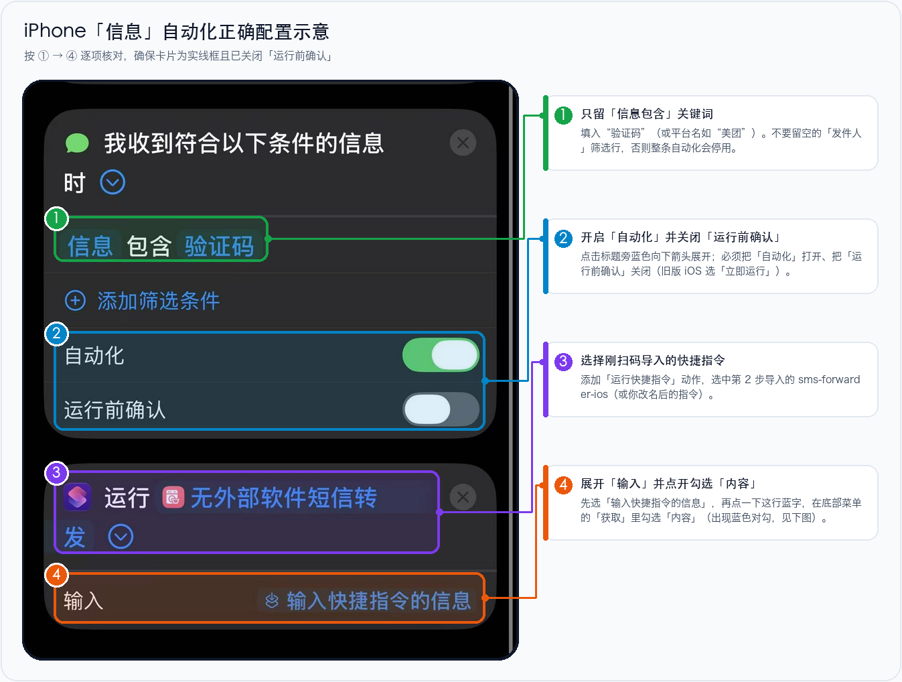
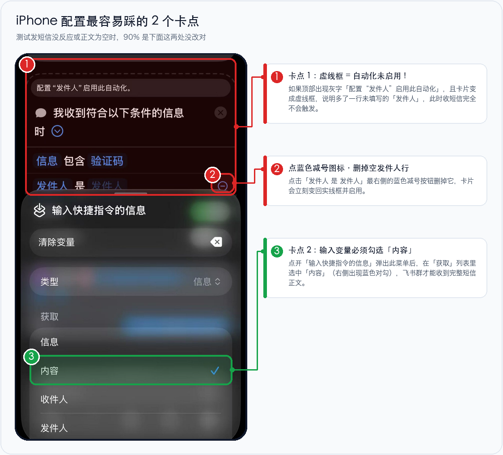

# iPhone 纯快捷指令版配置指南（免装任何 App）

这份指南面向非技术运营、店长与团队成员：无需从 App Store 安装任何第三方软件，只用 iPhone 自带的**「快捷指令」**，按下面 **4 步（约 3 分钟）** 即可把验证码自动转发到 **飞书、企业微信、钉钉或自定义 Webhook**。

> **选型提示**：纯快捷指令版不支持 HMAC-SHA256 签名校验（飞书与钉钉请使用**「自定义关键词：短信转发」**，企业微信本身无需签名）。如果团队要求开启飞书/钉钉加签、自定义 Webhook 签名，或把密钥隔离在本机钥匙串，请改用 [Scriptable 安全增强版](README.md#双轨选型对比)。

---

## 第 1 步：准备群机器人（30 秒）

- **飞书**：在接收群进入**群设置 → 群机器人 → 添加机器人 → 自定义机器人**，起名「短信转发」，复制 Webhook（`https://open.feishu.cn/open-apis/bot/v2/hook/...`）。安全设置中 ✅ **只勾选「自定义关键词」并填 `短信转发`**，❌ 不要勾选「签名校验」和「IP 白名单」。
- **企业微信**：在接收群添加群机器人，直接复制 Webhook（`https://qyapi.weixin.qq.com/cgi-bin/webhook/send?key=...`），无需额外安全设置。
- **钉钉**：在接收群添加自定义机器人，复制 Webhook（`https://oapi.dingtalk.com/robot/send?access_token=...`）。安全设置中 ✅ **只勾选「自定义关键词」并填 `短信转发`**，❌ 不要勾选「加签」和「IP 地址」。
- **自定义 Webhook**：准备接收 `POST` 请求的 HTTPS 地址，请求体为 `{"title":"短信转发","text":"..."}`。

---

## 第 2 步：扫码一键导入万能快捷指令（30 秒）

用 iPhone **自带相机**（不要用微信扫）扫描 [首页二维码](../README.md#扫码安装最新版android--iphone)，或在 Safari 中直接打开下载：

- **一键导入直链（万能版，四平台通用）**：[sms-forwarder-ios.shortcut](https://github.com/edward-zyz/sms-forwarder/releases/latest/download/sms-forwarder-ios.shortcut)
- <sub>已通过 Apple 官方 `shortcuts sign --mode anyone` 签名，构建源码公开可审计：[build-shortcut.py](build-shortcut.py)。单个快捷指令按 Webhook 域名自动识别飞书 / 企微 / 钉钉 / 自定义 Webhook。</sub>

Safari 打开后会自动跳进「快捷指令」App：
1. 点 **设置快捷指令**。
2. 第 1 题：粘贴刚复制的 **Webhook 地址**（飞书 / 企微 / 钉钉 / 自定义 HTTPS 均可），点下一步。
3. 第 2 题：填写 **本机号码或门店备注**（例如 `138****8888` 或 `浦东店·美团号`，留默认的 `iPhone` 也可以），点 **添加快捷指令**。

> **日后想微调？** 点开 `sms-forwarder-ios` 右上角 **`···`** 即可直接改：第 1 个「文本」是 Webhook（换群或换平台只改这里，自动切换格式），第 2 个「文本」是本机备注，第 3 个「文本」是转发文案模板。

---

## 第 3 步：先手动点一下，拿到「始终允许」授权（20 秒）

> **这一步千万不能省！** 如果不先在亮屏状态点一次「始终允许」，后面锁屏收到短信时，系统会静默拦截联网请求。

1. 在「快捷指令」首页，直接点一下刚添加的快捷指令卡片（如 `sms-forwarder-ios` 或对应平台名）。
2. 弹出系统提示**“允许将数据发送到对应域名吗？”** 时，点 **始终允许**。
3. 去接收群或目标服务确认收到一条测试消息：
   ```text
   短信转发
   接收手机：你刚才填的备注
   ```

---

## 第 4 步：设置「收到短信自动转发」并真机验证（1 分钟）

苹果在系统层面禁止别人直接分享「信息自动化」，这一步需要在收短信的 iPhone 上手动点一次。不同 iOS 版本的界面略有差异，但**核心只做 3 件事**：**设触发关键词** → **开自动运行** → **把短信「内容」传给刚导入的指令**。

### 4.1 创建「信息」触发条件

1. 打开「快捷指令」App，点底部中间的 **自动化** → 点右上角 **+**（或 **新建自动化**）→ 往下滑找到绿色短信图标的 **信息**。
2. 设置筛选条件：
   - **信息包含**：填入 `验证码`（或具体平台词，如 `美团`、`抖音来客`）。
   - **发件人**：**不要填、也不要留空行！**
   - ⚠️ **避坑 1（虚线框未启用）**：如果多点出了一行 `发件人 是 [发件人]`，整张卡片会变成**虚线框**并提示「配置“发件人”启用此自动化」，此时自动化**不会生效**！请点该行最右边的蓝色减号 **`⊖`** 把它删掉，卡片变回**实线框**才算启用。
3. 设为自动静默运行（不需要你点确认）：
   - **新版 iOS（卡片式界面）**：点 `我收到符合以下条件的信息时` 右边的展开箭头 **`>` / `∨`** → 确保 **自动化** 开关为绿色开启、**运行前确认** 为关闭。
   - **旧版 iOS（向导式界面）**：直接选中 **立即运行**（不要选「运行前询问」），点右上角 **下一步** → **新建空白自动化**。

### 4.2 绑定「运行快捷指令」并传短信「内容」

1. 在下方搜索框搜索并添加动作：**运行快捷指令**。
2. 在添加出来的卡片 `运行 [快捷指令]` 里完成两处点击：
   - ① 点浅色的 **快捷指令** → 选中第 2 步导入的 **sms-forwarder-ios**（如果你改过名，选你改后的名字）。
   - ② 点这一行右边的展开箭头 **`>` / `∨`** → 找到 **输入** → 点一下 → 选中 **快捷指令输入 / 输入快捷指令的信息**。
3. ⚠️ **避坑 2（必须把输入改为「内容」）**：
   - 选完后，**再点一下**蓝色的 `输入快捷指令的信息`（或 `快捷指令输入`）。
   - 在底部弹出的菜单里，找到 **获取** 列表，确认勾选了 **`内容 ✓`**（这样发到飞书群的才是完整短信正文，而不是空白或发件人对象）。
4. 点右上角 **完成**（或左上角 **`<`**）保存退出。



### 4.3 真机双态验证

1. **解锁态验证**：用**另一部手机**（⚠️ iPhone 自己给自己发短信不会触发自动化）给这台 iPhone 发一条普通绿色短信，内容包含你设置的关键词，例如：`【美团】测试验证码 482910`。等待 3–5 秒，确认飞书群完整收到正文。
2. **锁屏态验证**：将 iPhone 锁屏熄屏，再用另一部手机发一条测试短信，确认锁屏状态下也能正常送达。
   - 若锁屏未送达：在「快捷指令」首页点 `sms-forwarder-ios` 右上角 **`···`** → 底部 **`ⓘ`** → **隐私** → 确认已允许相关访问权限，并确认第 3 步已点过「始终允许」。

---

## 最常见 3 个卡点自查



| 现象 | 原因 | 解决办法 |
| --- | --- | --- |
| 发了测试短信，飞书群毫无反应 | ① 触发卡片呈**虚线框**，多了一行空的 `发件人 是 [发件人]`；<br>② 开了「运行前确认 / 运行前询问」；<br>③ 用同一台 iPhone 自己给自己发短信 | ① 点空发件人行右侧 **`⊖`** 删掉，让卡片变回实线框；<br>② 关闭「运行前确认」（或选「立即运行」）；<br>③ 用另一部手机发普通绿色短信测试 |
| 飞书群收到了消息，但正文为空或不对 | `运行快捷指令` 的 `输入` 未点开勾选 **内容** | 点开蓝色的 `输入快捷指令的信息`，在弹出菜单的 **获取** 列表里勾选 **`内容 ✓`** |
| 亮屏能转发，锁屏后收不到 | 第 3 步未在解锁态点「始终允许」，或重启后尚未解锁过一次 | 在亮屏态手动运行一次 `sms-forwarder-ios` 并点 **始终允许**；iPhone 重启后需先解锁一次 |

---

## iOS 系统边界说明

- **只能处理自动化传进来的短信**：无法主动监听所有短信，也不能读取历史收件箱；匹配多种不同关键词（如美团、抖音来客）可分别建多条自动化并复用同一个 `sms-forwarder-ios` 指令（注意条件不要重叠以免重复推送）。
- **无离线队列与自动重试**：断网、锁屏未放行或系统休眠导致自动化未触发时，短信会直接漏发。
- **不建议作为 7×24 无人值守接码机**：需要长期稳定接码、多群分流、断网自动补发的商家团队，请使用闲置旧安卓机（详见 [Android 使用指南](../docs/android.md)）。

---

<details>
<summary><strong>附录：手动从零搭建（或维护者自签离线包）</strong></summary>

如果你不想导入现成的 `.shortcut` 文件，也可以在「快捷指令」里手动建 3 个动作（使用原生词典 + `文件` 请求体可避免短信含换行或双引号时 JSON 破损）：

1. **文本**：填入你的本机号码或备注（如 `iPhone`）。
2. **词典**：
   - `msg_type`（文本）= `text`
   - `content`（词典）→ 内嵌 `text`（文本）=
     ```text
     短信转发
     接收手机：[第 1 步的文本]
     [快捷指令输入]
     ```
3. **获取 URL 内容**：
   - URL：粘贴飞书群机器人 Webhook
   - 方法：`POST`
   - 标头：`Content-Type` = `application/json; charset=utf-8`
   - 请求体：**文件** → 选第 2 步的 **词典**

**维护者重新生成并签名万能版 `.shortcut` 离线包（macOS，免费 Apple ID 即可）**：

```bash
python3 ios/build-shortcut.py --sign ios/sms-forwarder-ios.shortcut
```

</details>
